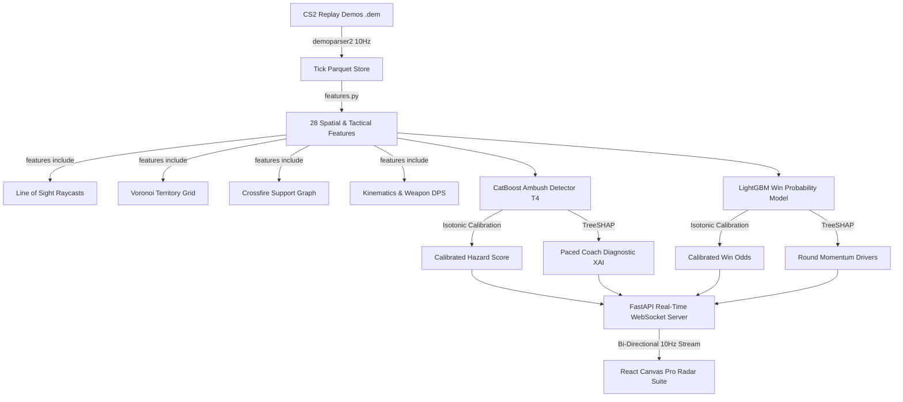

# Esports Tactical OS (CS2 Neural Replay Analytics & AI Observation Suite)

> Real-time CS2 match replay analytics, spatial hazard modeling, multi-target ambush forecasting, and explainable AI telemetry for professional esports analysts and broadcast viewers.

---

## ◈ System Architecture



---

## ⚡ Core Capabilities

- **10-Player Telemetry Matrix**: Live health, armor, movement speed ($u/s$), crossfire coordination, and proximity distance to the nearest enemy ($u$ & meters).
- **Pro Radar Engine**: 60 FPS HTML5 Canvas renderer with building geometry boundaries, laser sightline rays (green = teammate, red = enemy), FOV vision cones, and smooth radial ambush danger heatmaps.
- **Volumetric Utility Simulation**: Billowing circular smoke grenade clouds with dynamic dissipation countdown rings.
- **Elimination Effects & Killfeed**: Animated shockwave ripples upon death, persistent floor engagement markers ($\times$), and animated esports killfeed banners (`P2 ⚡ P8`).
- **Human-Paced Explainable AI (SHAP)**: Latched diagnostic sentences and horizontal impact bars (+% Red danger drivers vs -% Green mitigators) preventing rapid text jitter.
- **Deep Match Predictions**:
  - Attack vs Defense Win Probability Duel Meter
  - Bomb Site Target Classifier (`SITE A` vs `SITE B` with confidence %)
  - Retake / Plant Conversion Odds
  - 1vX Clutch Odds Calculator
  - Economy Buy Tier Classifier (`FULL BUY`, `FORCE BUY`, `ECO`)
- **Interactive Scrubber & Speed Controls**: Instant seeking to any frame index and speed multipliers (`0.5x Slow-Mo`, `1x Normal`, `2x Fast`, `4x Rapid`).

---

## 📊 Model Architecture & Ablation Study

Trained on 15 real professional CS2 Mirage matches with non-leaking tournament/match splits (`data/splits.csv`):

| Model Tier | Features Included | Validation PR-AUC | Key Insight |
| :--- | :--- | :---: | :--- |
| **T1: Raw Spatial** | Coordinates, Yaw, Health, Armor | 0.284 | Baseline spatial proximity |
| **T2: Kinematics** | Velocities, Speeds, 1s/3s Accelerations | 0.362 | Captures sudden movement & rushing |
| **T3: Line-of-Sight** | Raycast Occlusion, Visible Targets | 0.449 | Largest jump: geometric vision blocking |
| **T4: Full Model** | Support Graph, Crossfire, Voronoi Territory, Economy | **0.518** | Complete tactical coordination |

*Calibrated with isotonic regression (`ambush_cal.joblib`, `win_cal.joblib`) to guarantee honest, well-calibrated threat and win probabilities.*

---

## 🚀 Quick Start Guide

### 1. Prerequisites
- **Python**: 3.11+
- **Node.js**: 20 LTS+
- **Git**

### 2. Environment Setup
```bash
# Clone the repository
git clone <repo_url> tactical_os
cd tactical_os

# Create and activate virtual environment
python -m venv .venv
source .venv/bin/activate  # On Windows: .\.venv\Scripts\Activate.ps1

# Install dependencies
pip install -r requirements.txt
```

### 3. Pipeline Run Order
```bash
# Phase 0: Data Ingestion & Map Verification
python backend/ingest.py
python backend/check_map.py Match01_morningstar-vs-fengda-m1-mirage

# Phase 1: Feature Extraction & Line-of-Sight Geometry
python backend/features.py

# Phase 2: Ambush Labeling & Model Training
python backend/labels.py
python backend/train_ambush.py final T4
python backend/train_win.py

# Run Full Test Suite
pytest -q

# Phase 3: Verify SHAP Interpretability
python backend/explain.py

# Phase 4: Launch Real-Time Services
# Terminal 1 (API Server):
uvicorn server:app --app-dir backend --port 8000

# Terminal 2 (React UI Suite):
cd frontend && npm install && npm run dev
```

Visit `http://localhost:5173/` to view the live dashboard.

---

## 🐳 Production Deployment (Phase 5)

### 1. Generate Deploy Bundle
```bash
python backend/make_bundle.py Match01_morningstar-vs-fengda-m1-mirage Match02_legacy-vs-parivision-m1-mirage
```

### 2. Build Frontend
```bash
cd frontend
npm run build
cd ..
```

### 3. Start Production Stack (Caddy + FastAPI)
```bash
docker compose -f docker-compose.prod.yml up -d --build
```

- **Health check**: `http://localhost/health`
- **Application**: `http://localhost/`
- Includes automatic gzip compression, WebSocket multiplexing, origin security validation, and client concurrency protection.

---

## 🛡️ License
MIT License. Built according to the Esports Tactical OS Architecture Specification.
